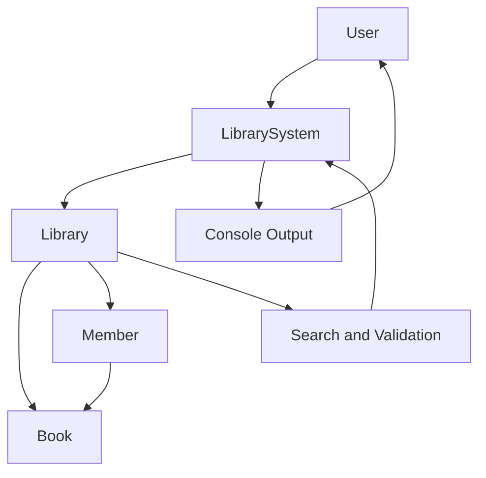

# System Architecture - Library Management System

## 1. Architecture Overview

The Library Management System follows a simple object-oriented, layered design. The application uses a console-based interface to accept user input and communicate with the library management logic.

## 2. System Components

### LibrarySystem
- Acts as the entry point of the application.
- Displays the menu and accepts user input.
- Calls the appropriate Library methods based on user choices.

### Library
- Manages the collection of books and registered members.
- Handles book searching, borrowing, and returning.
- Validates book and member records.

### Book
- Stores ISBN, title, author, genre, and availability.
- Provides methods to access and update book information.

### Member
- Stores member ID, name, and contact information.
- Maintains the list of borrowed books.
- Supports borrowing and returning books.

## 3. Component Interaction

1. The user selects an operation through LibrarySystem.
2. LibrarySystem passes the requested information to Library.
3. Library searches for the required Book or Member.
4. The relevant Book or Member object performs the requested operation.
5. The result is returned to LibrarySystem.
6. LibrarySystem displays the result in the console.

## 4. Architecture Diagram

## 5. Data Management

The application uses Java ArrayList collections to manage books, members, and borrowed books. Data is maintained in memory during program execution.

## 6. Design Principles

- Encapsulation: Data fields are private.
- Abstraction: Classes expose methods for required operations.
- Modularity: Each class has a specific responsibility.
- Reusability: Book and Member objects can be created and managed independently.

## 7. Limitations

The current application does not use a database or permanent file storage. All records are cleared when the application terminates.